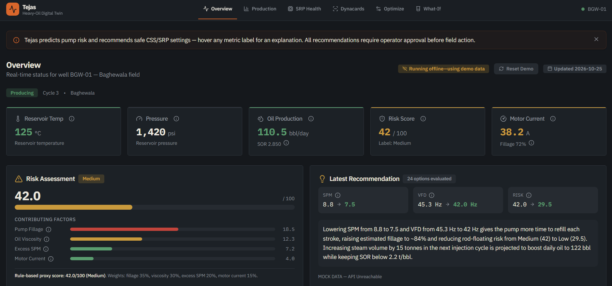
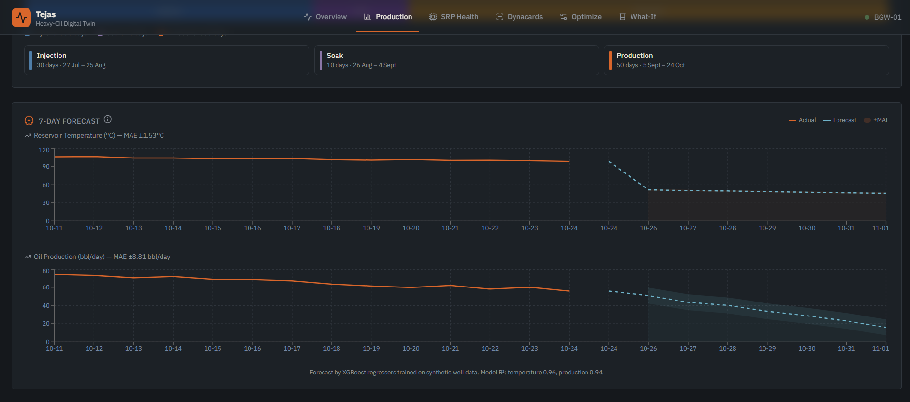
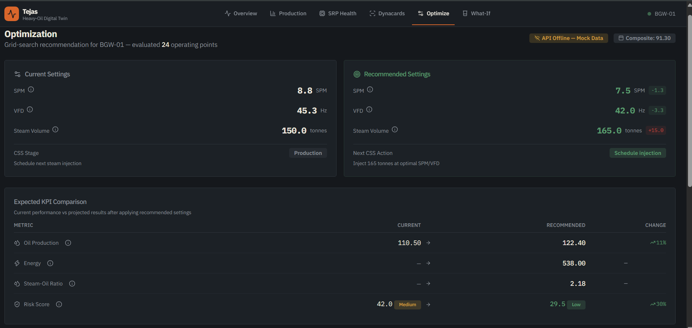
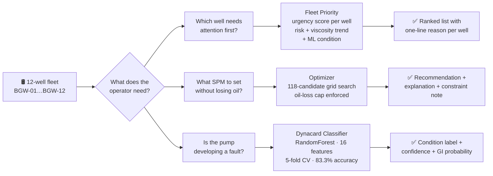
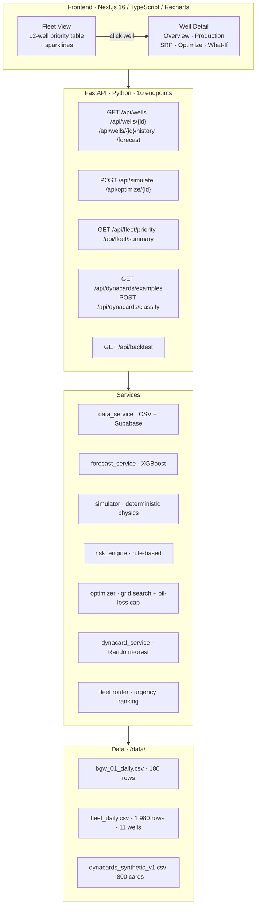
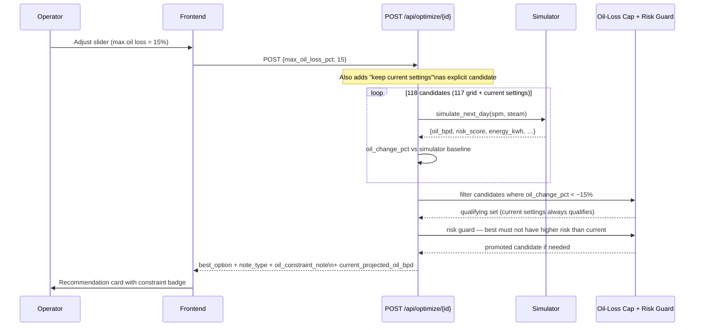

# Tejas — Decision-Support Digital Twin for Heavy-Oil Wells

> **One line:** Tejas watches a 12-well heavy-oil fleet, predicts pump faults before they cause downtime, and recommends the next safe operating point — with every number explained and every assumption labelled synthetic.

**Demonstration prototype — fully synthetic data.** Not connected to real Oil India field systems. Does not perform autonomous control. Every API response carries an explicit `data_note` disclaimer.


---

## 30-Second Summary

| | |
|---|---|
| **Problem** | Heavy-oil CSS wells need constant hand-tuning across three phases — inject, soak, produce. Oil viscosity swings 50× as the reservoir heats and cools. Pump faults show up days late. No fleet-level view exists. |
| **Solution** | A digital twin that monitors 12 wells simultaneously, forecasts 7-day production per well, scores pump-fault risk in real time, recommends the next safe operating point with an oil-loss guard, and classifies dynamometer card shapes into four pump conditions. |
| **What's different** | Three layers of honesty built in: the optimizer enforces a configurable oil-loss cap so recommendations can't sacrifice production for risk; the ML classifier and rule-based risk engine surface disagreements instead of hiding them; every metric comes with a labelled source ("recorded today" vs "model projection"). |
| **Why trust it** | 212 tests across 9 files. Classifier evaluated with 5-fold stratified CV (not one lucky split). Backtest records the exact optimizer settings used. Two prior leakage bugs were caught, documented, and fixed — the commit history shows the reasoning. |

---

## Demo

| | |
|---|---|
| 🖥️ Live demo | https://tejas-navy.vercel.app/ |
| 🎥 Video walkthrough | https://youtu.be/V4qazCjrN8g |

| Fleet Overview | Well Detail — Overview |
|---|---|
|  |  |

| Optimizer | Dynacard Classifier |
|---|---|
|  |  |

---

## The Problem in Plain English

A sucker-rod pump (SRP) lifts oil from the bottom of a well. A **dynamometer card** — a load-vs-position trace of the pump rod — reveals what is happening underground without pulling the pump. Four conditions matter:

- **Normal** — pump is filling correctly on each stroke.
- **Fluid Pound** — the barrel isn't full; the plunger slams into liquid mid-stroke (shock load, equipment damage).
- **Rod Floating** — the rod string floats on fluid; pump speed is too high or fluid level too low.
- **Gas Interference** — gas compresses in the barrel before liquid is picked up, reducing efficiency and rounding the card shape.

In a CSS well, viscosity changes dramatically as the reservoir heats and cools. A pump speed that was safe after injection may cause rod floating two weeks into production. Operators currently catch this by eye, after the fact. Tejas catches it earlier.



---

## System Architecture



---

## Optimizer Sequence (with oil-loss cap)



---

## Features

| Feature | Detail |
|---|---|
| **Fleet view — 12 wells** | Urgency-ranked priority table with sortable columns, per-well sparklines, and one-line reason built from real measured values (risk score, viscosity trend, ML condition). Clicking a row opens the single-well detail view. |
| **7-day recursive forecast** | Two XGBoost regressors (temperature + production) roll forward day-by-day, each day's output feeding as lag into the next. MAE error bars on every chart. |
| **What-if simulator** | Override SPM (4–10), steam (100–260 t), soak days (3–6), or VFD (30–50 Hz). Deterministic physics — no ML, runs in < 1 ms. |
| **Grid-search optimizer + oil-loss cap** | 118 candidates (117 grid + current settings). Composite objective: `production − 0.35·SOR − 0.25·energy − 0.50·risk`. A configurable `max_oil_loss_pct` (default 15%) filters out any candidate that projects more than that loss vs the model's own baseline. Current settings is always a valid fallback. |
| **Risk guard** | If the highest-scoring candidate projects higher risk than the current settings, the optimizer automatically promotes "keep current settings" and surfaces a labelled `note_type: "risk_guard"` warning. |
| **Oil baseline consistency** | `oil_change_pct` is computed relative to the simulator's projection at current settings (`current_projected_oil_bpd`), not the noisy CSV value. The Overview card shows both "recorded today" and "model projection" with an amber calibration warning if they differ by > 25%. |
| **Pump-fault classifier** | RandomForest on 16 features extracted from the 200-point dynamometer card curve. 5-fold stratified CV: 83.3% accuracy, 83.1% macro-F1. Gas Interference recall: 69.6% at low severity → 100% at high severity (gradient confirmed). |
| **Gas Interference confidence gate** | GI predictions below 50% confidence return `"Gas Interference (low confidence)"`. Raw GI probability always present in the response for dashboards. |
| **ML × rule-based cross-check** | After selecting the best candidate, the optimizer runs the classifier on the current observed well state. Disagreements appear as a structured `ml_diagnosis_warning` — never silently discarded. |
| **Transparent risk engine** | 4-factor weighted formula (fillage 35%, viscosity 30%, SPM excess 20%, motor current 15%). Every response breaks the score into additive components. |
| **Backtest** | 180-day replay of BGW-01 comparing Tejas recommendations against the recorded baseline. Both arms use the same simulator. Stored in `data/backtest_results.json` with all optimizer settings recorded so results are reproducible. |

---

## ML Metrics

All numbers are read directly from `backend/models/*.json` at runtime — no manual transcription.

### Dynacard Classifier  (RandomForest · 5-fold stratified CV · 800 synthetic cards)

| Metric | Value |
|---|---|
| Overall accuracy | **83.3%** ± 2.9% |
| Macro-F1 | **83.1%** ± 3.1% |
| Gas Interference precision | 88.9% ± 3.8% |
| Gas Interference recall | 90.0% ± 2.7% |
| Training set | 800 cards · 200 per class · severity-continuous generator |

**Gas Interference recall by severity — gradient confirms no overfitting:**

| Tercile | n | Recall | F1 | Interpretation |
|---|---|---|---|---|
| Low (0.10–0.27) | 56 | **69.6%** | 0.821 | Mild GI overlaps Normal — expected |
| Mid (0.27–0.38) | 42 | 92.9% | 0.963 | Clear signal |
| High (0.39–0.70) | 102 | 100.0% | 1.000 | Unambiguous |

**Top features:** `load_pickup_pos` 26.8% · `enclosed_area` 16.3% · `top_curvature` 15.6%. All computed from raw curve arrays at inference — no generator-internal columns (a previous target-leakage bug was caught and fixed).

### Forecast Models  (XGBoost · time-based split — last 25 of 180 rows as test)

| Target | MAE | R² |
|---|---|---|
| Reservoir temperature | **1.53 °C** | 0.961 |
| Oil production | **8.81 bbl/day** | 0.942 |

> R² looks strong because the physics are deterministic and the model learns the governing equations. Not evidence of real-world generalisation.

---

## Backtest Results

180-day replay comparing Tejas recommendations against the recorded baseline.
Both arms are evaluated by the same simulator — any improvement is within-model.
Settings used: `max_oil_loss_pct=15`, SPM range 4.0–10.0 step 0.5, steam 100–260 t step 20.

| Metric | Baseline | Tejas | Delta | Note |
|---|---|---|---|---|
| High-risk days | 26 | **0** | −26 ↓ | Real within-model |
| Avg risk score | 39.81 | **31.79** | −8.02 ↓ | Real within-model |
| Total oil (bbl) | 12,593.4 | **12,593.4** | 0.0 = | Oil protected by cap |
| Total energy (kWh) | 15,556 | **9,588** | −5,968 ↓ | Optimistic — model artifact |
| Avg SOR | 0.149 | **0.149** | 0.0 = | Not pump-sensitive |

**Important caveats:**
- The optimizer uses the same simulator to score candidates — it cannot appear worse on simulated metrics.
- The energy saving (−38%) comes from lower recommended SPM. In the simulator, oil production is the minimum of reservoir inflow and pump capacity; on cold high-viscosity days the reservoir is limiting and SPM can drop without losing oil. This is mechanically correct in the model but optimistic as a field prediction.
- The oil delta is exactly 0.0 because `oil_change_pct` is now measured against the simulator's own baseline (not the noisy CSV value), making the current-settings candidate always the exact reference point.

---

## Risk Score Formula

```
risk = 0.35 × fillage_component       (how empty the pump barrel is)
     + 0.30 × viscosity_component     (how thick the oil is)
     + 0.20 × spm_excess_component    (pump too fast for current viscosity)
     + 0.15 × motor_current_component (motor straining above 35 A)
```

| Label | Range |
|---|---|
| 🟢 Low | ≤ 35 |
| 🟡 Medium | 36–65 |
| 🔴 High | > 65 |

Weights are demo assumptions — not calibrated from real failure data.

---

## API Reference

| Method | Path | What it does |
|---|---|---|
| `GET` | `/api/wells` | All 12 wells — status, risk score, ML condition |
| `GET` | `/api/wells/{id}` | Single well full status |
| `GET` | `/api/wells/{id}/history?days=90` | Daily records |
| `GET` | `/api/wells/{id}/forecast?days=7` | 7-day XGBoost forecast with MAE |
| `POST` | `/api/simulate` | What-if projection |
| `POST` | `/api/optimize/{id}` | Grid-search + oil-loss cap + risk guard |
| `GET` | `/api/fleet/priority` | Wells ranked by urgency with one-line reasons |
| `GET` | `/api/fleet/summary` | Fleet totals — oil, energy, risk distribution |
| `GET` | `/api/dynacards/examples` | One example card per condition |
| `POST` | `/api/dynacards/classify` | Classify a 200-point dynamometer card |
| `GET` | `/api/backtest` | Pre-computed 180-day backtest results |

Interactive docs: `http://localhost:8000/docs`

---

## Quick Start

### Prerequisites

- Python 3.11+, Node.js 20+

```bash
# Copy env file and add optional Supabase creds (app works without them)
cp shakti-sih/backend/.env.example shakti-sih/backend/.env
```

### Backend

```bash
cd shakti-sih/backend
python -m venv venv
source venv/bin/activate          # Windows: venv\Scripts\activate

pip install -r requirements.txt

# Train models (required before first run)
python scripts/train_forecast_model.py
python scripts/train_dynacard_classifier.py

# Generate fleet data for BGW-02..BGW-12
python scripts/generate_fleet.py

# Optional: regenerate backtest results
python scripts/backtest.py

uvicorn app.main:app --reload --port 8000
# → API at http://localhost:8000
# → Swagger at http://localhost:8000/docs
```

### Frontend

```bash
cd shakti-sih/frontend
npm install
npm run dev
# → http://localhost:3000/dashboard/fleet
```

### Tests

```bash
cd shakti-sih/backend
pytest tests/ -v
# 212 tests across 9 test files
```

---

## Limitations

| Limitation | Detail |
|---|---|
| **All data is synthetic** | Every CSV was generated from physics models. Every API response says so. |
| **Fleet wells are not calibrated to BGW-01** | BGW-02..12 were generated with per-well parameters (different `oil_max`, `decay_tau`, `spm_setpoint`). The simulator uses BGW-01 constants (OIL_MAX=220, etc.) for all wells — this creates calibration gaps of up to 59% on some wells. The Overview flags gaps > 25% with an amber note. |
| **Forecast evaluated on 25 rows** | R² reflects learning the deterministic physics, not generalisation to heterogeneous reservoirs. |
| **GI recall 69.6% at low severity** | Mild gas interference overlaps Normal by design. Cases are flagged "low confidence" rather than silently classified Normal. |
| **Oil-loss cap uses a simulator baseline, not field measurements** | `oil_change_pct` is relative to what the simulator projects at current SPM — not the recorded CSV oil. The gap between the two is the calibration gap described above. |
| **Optimizer scores hypothetical candidates with the rule-based risk formula** | No real dynacard exists for a setting not yet applied. The ML classifier runs on current state only and cross-checks the rule-based result. |
| **VFD fixed at 42 Hz** | Near-zero observed correlation with motor current in the synthetic data. Real VFD optimisation needs wider operating-range data. |
| **Risk weights are demo assumptions** | 0.35 / 0.30 / 0.20 / 0.15 — not derived from failure statistics. |
| **No authentication** | Demo only. |

---

## Deployment

### Frontend → Vercel

```
Root Directory: shakti-sih/frontend
Framework: Next.js
Env var: NEXT_PUBLIC_API_URL=https://your-backend-url/api
```

### Backend → Render

```
Root Directory:   shakti-sih/backend
Build command:    pip install -r requirements.txt &&
                  python scripts/train_forecast_model.py &&
                  python scripts/train_dynacard_classifier.py &&
                  python scripts/generate_fleet.py
Start command:    uvicorn app.main:app --host 0.0.0.0 --port $PORT
Env vars:         ALLOWED_ORIGINS=https://tejas-navy.vercel.app,http://localhost:3000
                  SUPABASE_URL=...  SUPABASE_SECRET_KEY=...  (optional)
```

---

## Tech Stack

| Layer | Technology |
|---|---|
| Frontend | Next.js 16.3.4, TypeScript, Recharts 3, Tailwind CSS 4, Radix UI |
| Backend | FastAPI, Python 3.11+, Pydantic v2, Uvicorn |
| ML — forecast | XGBoost 2.x (two separate regressors, recursive) |
| ML — classifier | scikit-learn RandomForest (300 trees, balanced weights, 5-fold CV) |
| Feature engineering | NumPy, SciPy (ConvexHull, trapezoid integration) |
| Data | pandas · 3 synthetic CSV files · 2 340 total rows · 12 wells |
| Tests | pytest + httpx · **212 tests** across 9 files |
| Optional persistence | Supabase (Postgres) — app works without it |

---

## Project Structure

```
tejas/
├── shakti-sih/
│   ├── backend/
│   │   ├── app/
│   │   │   ├── main.py              # FastAPI app, CORS
│   │   │   ├── models.py            # Pydantic schemas
│   │   │   ├── routers/             # wells · simulate · optimize
│   │   │   │                        # dynacards · fleet · backtest
│   │   │   └── services/            # 7 service modules
│   │   ├── data/
│   │   │   ├── bgw_01_daily.csv     # 180 rows — BGW-01 history
│   │   │   ├── fleet_daily.csv      # 1 980 rows — BGW-02..12
│   │   │   └── dynacards_synthetic_v1.csv  # 800 cards
│   │   ├── models/                  # .pkl + JSON metadata
│   │   ├── scripts/
│   │   │   ├── generate_dynacards.py   # severity-continuous card gen
│   │   │   ├── generate_fleet.py       # 11-well fleet data
│   │   │   ├── train_dynacard_classifier.py
│   │   │   ├── train_forecast_model.py
│   │   │   └── backtest.py             # 180-day replay
│   │   └── tests/                   # 212 tests across 9 files
│   ├── frontend/
│   │   ├── src/app/dashboard/
│   │   │   ├── fleet/               # Fleet priority view (landing)
│   │   │   ├── page.tsx             # Well detail — Overview
│   │   │   ├── production/          # Forecast + thermal
│   │   │   ├── srp/                 # Dynacard + SRP health
│   │   │   ├── optimize/            # Optimizer + oil-loss slider
│   │   │   ├── simulate/            # What-if simulator
│   │   │   └── dynacards/           # Card classifier
│   │   └── src/components/
│   └── docs/
│       └── assumptions.md
└── README.md
```

---

## Roadmap

| Priority | Item |
|---|---|
| P1 | SCADA / OPC-UA live data feed — replace synthetic CSVs |
| P1 | Calibrate simulator constants and risk weights per well against real failure data |
| P2 | Per-well model registry (separate XGBoost models per well) |
| P2 | Real dynacard acquisition hardware integration |
| P3 | GI classifier retrained on field-labelled cards |
| P3 | VFD grid-search once wider operating-range data is available |
| P3 | Alerting layer — email/SMS on High risk transitions |
| P4 | User authentication and role-based access |

---

## Team

| Name | Role |
|---|---|
| Sreejeeta Roy | Team Leader |
| Suryansh Singh | Team Member |
| Priyanka Chourasia | Team Member |
| Rahul Rajput | Team Member |
| Raj Vashisht | Team Member |
| Saanvi Jaiswal | Team Member |

Institution: BMS College of Engineering, Bangalore  
SIH Problem Statement ID: SIH26120

---

## Licence

Prototype built for Smart India Hackathon 2025. All data is synthetic.

---

*"Tejas" (तेजस) — brightness, radiance.*
