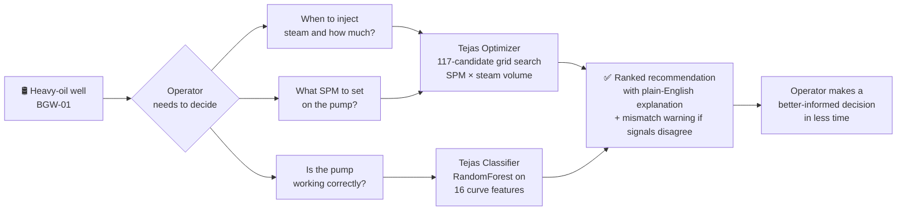
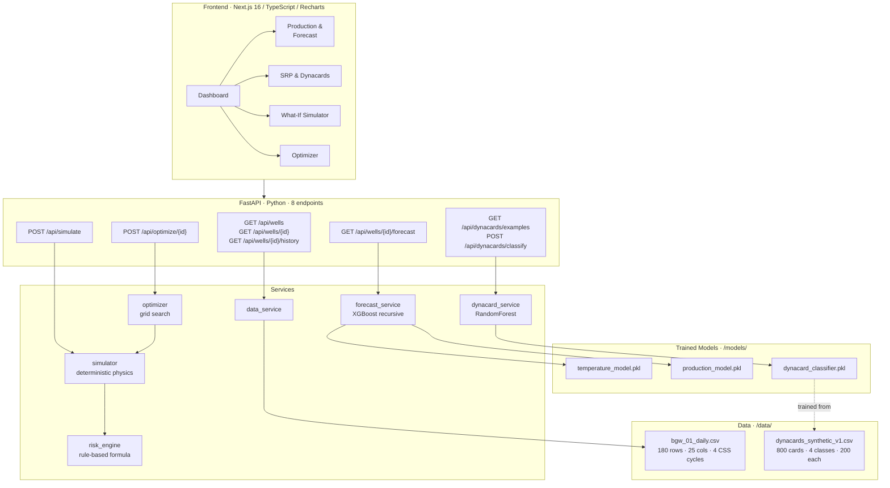
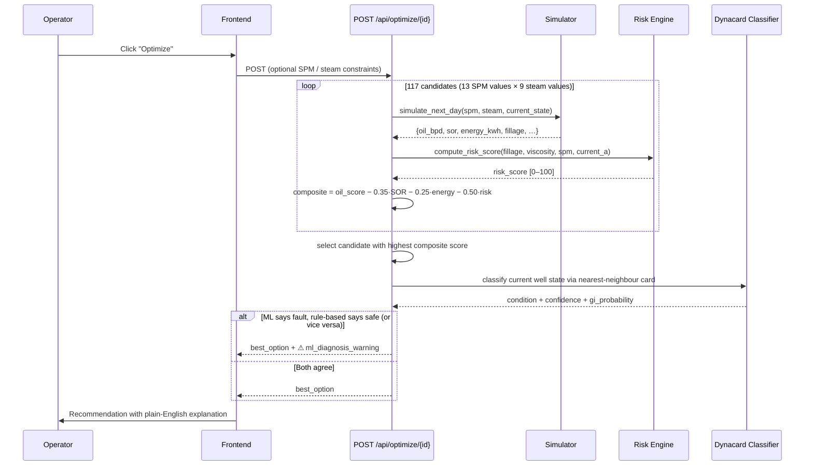

# Tejas — Decision-Support Digital Twin for Heavy-Oil Wells

> **One line:** Tejas turns a heavy-oil well's daily operating data into actionable recommendations — when to inject steam, how fast to pump, and whether the pump is developing a fault — before a human operator would catch it.

**This is a demonstration prototype using fully synthetic data.** It is not connected to real Oil India field systems and does not perform autonomous control. Every API response carries an explicit `data_note` disclaimer.

   

---

## 30-Second Summary

| | |
|---|---|
| **Problem** | BGW-01 is a heavy-oil well under Cyclic Steam Stimulation (CSS). Oil viscosity swings 50× as the reservoir heats and cools. Operators hand-tune pump speed and steam volume across three phases — inject, soak, produce — with no decision support. Pump faults go undetected until damage is done. |
| **Solution** | A digital twin that ingests daily well data, forecasts 7-day production and temperature, scores pump-fault risk in real time, recommends the best next operating point, and classifies dynamometer cards into four pump conditions with an ML model. |
| **What's different** | Every recommendation comes with a plain-English explanation ("reduce SPM — fillage deficit is the largest risk driver") and a confidence score. Where the ML classifier and rule-based risk engine disagree, the system surfaces a structured mismatch warning instead of silently picking one signal. |
| **Why trust it** | Classifier evaluated with 5-fold stratified CV. Forecast error bars (MAE) shown on every chart. Stale numbers in this README were caught and corrected — see the list at the bottom. |

---

## Demo

| | |
|---|---|
| 🖥️ Live demo | `<!-- TODO: Vercel / Render URL -->` |
| 🎥 Video | `<!-- TODO: YouTube / Drive link -->` |
| 📊 Slides | `<!-- TODO: Google Slides / PDF -->` |

`<!-- TODO: drag screenshots into the table below -->`

| Dashboard | Optimizer | Dynacard Classifier |
|---|---|---|
| *(screenshot)* | *(screenshot)* | *(screenshot)* |

---

## The Problem in Plain English

A sucker-rod pump (SRP) lifts oil from the bottom of a well. A **dynamometer card** is a load-vs-position trace of the pump rod — its shape reveals what's happening underground. Four conditions matter:

- **Normal** — pump is working correctly.
- **Fluid Pound** — the pump barrel isn't full; the plunger slams into liquid mid-stroke, causing shock loads.
- **Rod Floating** — the rod string floats on fluid because pump speed is too low or fluid level is too high.
- **Gas Interference** — gas in the barrel compresses before liquid is picked up, rounding the card shape and reducing efficiency.

In a heavy-oil CSS well, oil viscosity changes dramatically as the reservoir heats and cools. A pump speed that was correct after steam injection may cause rod floating two weeks later as the well cools down. Operators currently detect this by eye, after the fact.



---

## System Architecture



---

## Optimizer Sequence



---

## Features

| Feature | Detail |
|---|---|
| **7-day recursive forecast** | Two XGBoost regressors (temperature + production) roll forward day-by-day, feeding their own output as the next lag input. MAE error bars displayed on every chart. |
| **What-if simulator** | Override SPM (4–10), steam volume (100–260 t), soak days (3–6), or VFD (30–50 Hz). Deterministic physics projection runs in < 1 ms — no ML involved. |
| **Grid-search optimizer** | 117 candidates (13 SPM × 9 steam values). Composite objective: `production − 0.35·SOR − 0.25·energy − 0.50·risk`. Returns best option with explanation and top alternatives. |
| **Cycle-level planner** | Separate CSS cycle optimizer: grid-searches steam volume, injection pressure (1200–1600 psi), and soak duration (3–6 days). Simulates full inject→soak→production arc to a cutoff trigger (oil < 15 bpd AND trailing SOR > 0.35). |
| **Pump-fault classifier** | RandomForest on 16 features from the 200-point dynamometer card curve. 5-fold stratified CV: 83.3% accuracy, 83.1% macro-F1. |
| **Gas Interference confidence gate** | If the model predicts Gas Interference with < 50% probability, the API returns `"Gas Interference (low confidence)"` rather than suppressing the signal. Raw GI probability is always included. |
| **ML × rule-based cross-check** | After the optimizer picks its best candidate, it runs the classifier on the current well state. If both signals disagree at high confidence, a structured warning appears in the response — not a silent override. |
| **Transparent risk engine** | 4-factor weighted formula. Every response breaks the score into its four additive components so operators can see what's driving it. |

---

## ML Metrics

All numbers come directly from the model metadata files in `backend/models/`.

### Dynacard Classifier  (RandomForest · 5-fold stratified CV)

| Metric | Value |
|---|---|
| Overall accuracy | **83.3%** ± 2.9% |
| Macro-F1 | **83.1%** ± 3.1% |
| GI precision | 88.9% ± 3.8% |
| GI recall | 90.0% ± 2.7% |
| Training set | 800 synthetic cards · 200 per class |

**Gas Interference by severity — the gradient should exist (flat 100% would signal overfitting):**

| Severity tercile | n | Recall | F1 |
|---|---|---|---|
| Low (0.10–0.27) | 56 | **69.6%** | 0.821 |
| Mid (0.27–0.38) | 42 | 92.9% | 0.963 |
| High (0.39–0.70) | 102 | 100.0% | 1.000 |

**Top features by importance:** `load_pickup_pos` (26.8%), `enclosed_area` (16.3%), `top_curvature` (15.6%). All three are derived from the raw curve at inference time — no generator-internal columns are used (removing a previous target-leakage bug).

### Forecast Models  (XGBoost · time-based split — last 25 of 180 rows as test)

| Target | MAE | R² |
|---|---|---|
| Reservoir temperature | **1.53 °C** | 0.961 |
| Oil production | **8.81 bbl/day** | 0.942 |

> These numbers look strong because the physics are deterministic and the model learns the governing equations. They do not represent real-world generalisation to heterogeneous reservoirs.

---

## Risk Score Formula

Transparent rule-based scoring — not a black box:

```
risk = 0.35 × fillage_component       (how empty the pump barrel is)
     + 0.30 × viscosity_component     (how thick the oil is)
     + 0.20 × spm_excess_component    (pump running too fast for thick oil)
     + 0.15 × motor_current_component (motor straining above 35 A)
```

| Label | Range |
|---|---|
| 🟢 Low | ≤ 35 |
| 🟡 Medium | 36–65 |
| 🔴 High | > 65 |

---

## API Reference

| Method | Path | What it does |
|---|---|---|
| `GET` | `/api/wells` | List all wells with status, risk score, and ML condition |
| `GET` | `/api/wells/{id}` | Single well full status |
| `GET` | `/api/wells/{id}/history?days=90` | Daily records for last N days |
| `GET` | `/api/wells/{id}/forecast?days=7` | 7-day recursive XGBoost forecast with MAE |
| `POST` | `/api/simulate` | What-if: override SPM / steam / soak / VFD |
| `POST` | `/api/optimize/{id}` | Grid-search best operating point |
| `GET` | `/api/dynacards/examples` | One example card per condition label |
| `POST` | `/api/dynacards/classify` | Classify a 200-point dynamometer card |

Interactive docs at `http://localhost:8000/docs`.

---

## Quick Start

### Prerequisites

- Python 3.11+, Node.js 20+
- Copy `backend/.env.example` → `backend/.env` and fill in two values:

```
SUPABASE_URL=your_project_url
SUPABASE_SECRET_KEY=your_secret_key
```

> The API works without Supabase — it reads local CSV files. The env vars are only needed if you use the optional Supabase persistence layer.

### Backend

```bash
cd shakti-sih/backend

python -m venv venv
# Windows:
venv\Scripts\activate
# macOS / Linux:
source venv/bin/activate

pip install -r requirements.txt

# Train models (required before first run)
python scripts/train_forecast_model.py
python scripts/train_dynacard_classifier.py

uvicorn app.main:app --reload --port 8000
```

### Frontend

```bash
cd shakti-sih/frontend
npm install
npm run dev
# Open http://localhost:3000/dashboard
```

### Tests

```bash
cd shakti-sih/backend
pytest tests/ -v
# 116 tests across 8 test files
```

### Regenerate synthetic data (optional)

```bash
# Regenerate dynacard training set (800 cards, 200 per class, severity-continuous)
python scripts/generate_dynacards.py --n-per-class 200 --seed 42
python scripts/train_dynacard_classifier.py
```

---

## Limitations

Real weaknesses, stated plainly — judges reward honesty more than spin.

| Limitation | Detail |
|---|---|
| **All data is synthetic** | `bgw_01_daily.csv` is 180 rows from a physics model, not real Oil India measurements. Every API response carries a `data_note` field saying so. |
| **Single well** | Built around BGW-01. Multi-well support needs schema and routing changes. |
| **Forecast test set is thin** | 25 rows from one synthetic time series. The R² values reflect learning deterministic equations, not generalisation to real reservoir heterogeneity. |
| **Low-severity GI recall is 69.6%** | Mild Gas Interference (early-stage, subtle gas entry) overlaps Normal by design. These cases are flagged as "low confidence" rather than silently classified. |
| **Optimizer uses a rule-based risk proxy** | The optimizer scores hypothetical SPM/steam candidates with the rule-based formula — there is no real dynacard for a setting that hasn't been applied yet. The two signals are explicitly tagged and cross-checked. |
| **VFD is not grid-searched** | In the synthetic data, VFD varies only 38.5–45.7 Hz with near-zero correlation to motor current (r = 0.008). The optimizer holds VFD fixed at 42 Hz. Real VFD optimisation needs better data. |
| **Risk weights are demo assumptions** | The 0.35 / 0.30 / 0.20 / 0.15 weights are not calibrated from real failure data. |
| **No authentication** | The API has no auth layer. Demo only. |

---

## Deployment

### Frontend → Vercel

1. Go to [vercel.com/new](https://vercel.com/new), import this repo.
2. Set **Root Directory** to `shakti-sih/frontend`.
3. Framework preset: **Next.js**. Deploy.
4. Add env var `NEXT_PUBLIC_API_URL=https://your-backend-url/api` in project settings.

### Backend → Render

1. New Web Service → connect this repo.
2. Root Directory: `shakti-sih/backend`
3. Build: `pip install -r requirements.txt && python scripts/train_forecast_model.py && python scripts/train_dynacard_classifier.py`
4. Start: `uvicorn app.main:app --host 0.0.0.0 --port $PORT`
5. Add env vars: `SUPABASE_URL`, `SUPABASE_SECRET_KEY`.

---

## Roadmap

| Priority | Item |
|---|---|
| P1 | Connect to real SCADA / OPC-UA data feed — replace synthetic CSV |
| P1 | Calibrate risk weights and simulator constants against real failure events |
| P2 | Multi-well support and per-well model registry |
| P2 | Real dynacard acquisition hardware integration |
| P3 | GI classifier retrained on real labelled cards |
| P3 | VFD optimisation once wider operating-range data is available |
| P3 | Alerting layer (email / SMS on High risk transitions) |
| P4 | User authentication and role-based access |

---

## Tech Stack

| Layer | Technology |
|---|---|
| Frontend | Next.js 16.3.4, TypeScript, Recharts 3, Tailwind CSS 4, Radix UI |
| Backend | FastAPI, Python 3.11+, Pydantic v2, Uvicorn |
| ML — forecast | XGBoost 2.x (two separate regressors) |
| ML — classifier | scikit-learn RandomForest (300 trees, balanced class weights, 5-fold CV) |
| Feature engineering | NumPy, SciPy (ConvexHull, trapezoid integration) |
| Data | pandas, synthetic CSV files (no database required) |
| Tests | pytest + httpx — 116 tests across 8 files |
| Optional persistence | Supabase (Postgres) |

---

## Project Structure

```
tejas/
├── shakti-sih/
│   ├── backend/
│   │   ├── app/
│   │   │   ├── main.py              # FastAPI app, CORS, router registration
│   │   │   ├── models.py            # Pydantic request/response schemas
│   │   │   ├── routers/             # wells · simulate · optimize · dynacards
│   │   │   └── services/            # 6 service modules
│   │   ├── data/
│   │   │   ├── bgw_01_daily.csv     # 180-row synthetic well history
│   │   │   └── dynacards_synthetic_v1.csv  # 800 synthetic cards
│   │   ├── models/                  # trained .pkl files + JSON metadata
│   │   ├── scripts/
│   │   │   ├── generate_dynacards.py        # v3 severity-continuous generator
│   │   │   ├── train_dynacard_classifier.py # 5-fold CV, 16 features
│   │   │   └── train_forecast_model.py      # XGBoost, time-based split
│   │   ├── tests/                   # 116 pytest tests (8 files)
│   │   └── requirements.txt
│   ├── frontend/
│   │   ├── src/app/                 # 8 Next.js pages
│   │   └── src/components/          # 16 UI components + 6 chart components
│   └── docs/
│       └── assumptions.md           # explicit modelling assumptions
└── README.md                        # ← you are here
```

---

## Team

| Name | Role |
|---|---|
| `<!-- TODO -->` | `<!-- TODO -->` |
| `<!-- TODO -->` | `<!-- TODO -->` |
| `<!-- TODO -->` | `<!-- TODO -->` |

Institution: `<!-- TODO -->`  
SIH Problem Statement: `<!-- TODO: PS number and title -->`

---

## Licence

Prototype built for Smart India Hackathon 2025. All data is synthetic.

---

*"Tejas" (तेजस) — brightness, radiance.*
