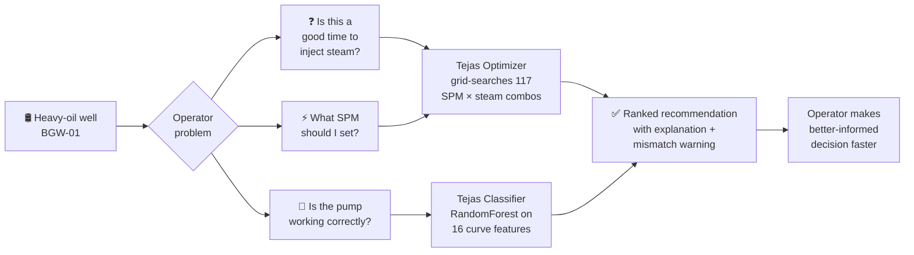
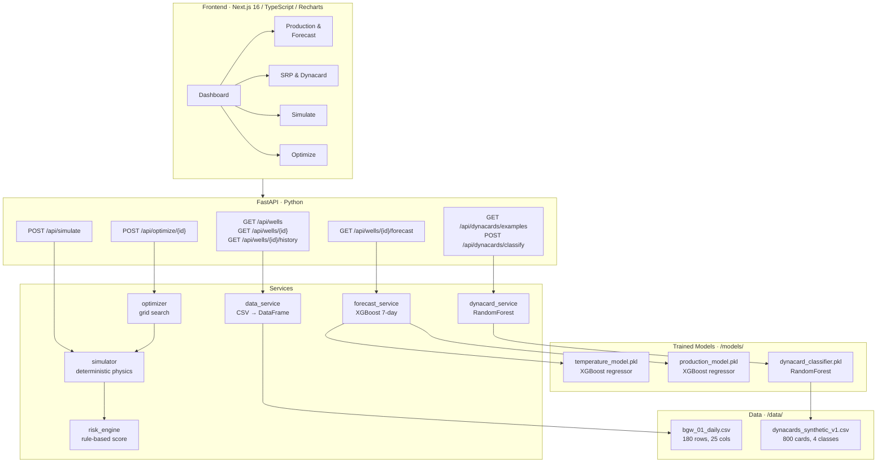
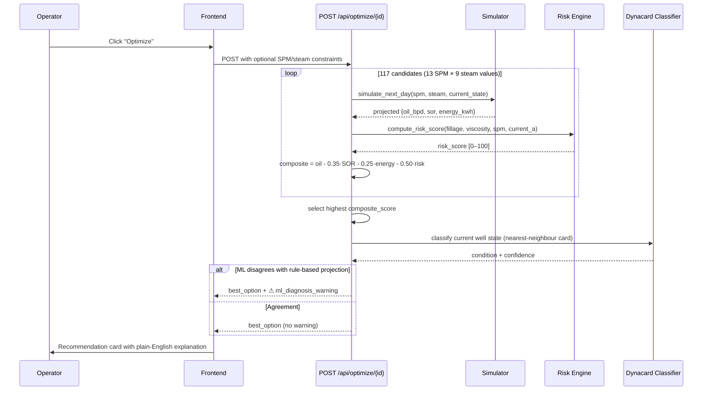

# Tejas — Decision-Support Digital Twin for Heavy-Oil Wells

> **One line:** Tejas turns a heavy-oil well's live operating data into actionable recommendations — when to inject steam, how fast to pump, and when a pump fault is developing — before a human operator would catch it.

---

## 30-Second Summary

| | |
|---|---|
| **Problem** | BGW-01 is a heavy-oil well in a Cyclic Steam Stimulation (CSS) programme. Oil viscosity swings 50× between cold and hot reservoir states. Operators must hand-tune pump speed (SPM) and steam volume across three phases — inject, soak, produce — with no decision support. Faults go undetected until the pump fails. |
| **Solution** | A digital twin that ingests daily well data, forecasts 7-day production and temperature, scores pump-fault risk in real time, recommends the next operating point, and classifies dynamometer cards into four pump conditions with an ML model. |
| **What's different** | Every recommendation comes with an *explanation* ("reduce SPM because viscosity-driven fillage deficit is the largest risk contributor") and a *confidence score*. Where the ML classifier and the rule-based risk engine disagree, the system surfaces a mismatch warning rather than silently picking one. |
| **Why trust it** | Classifier evaluated with 5-fold stratified CV (not a single lucky split). Forecast error bars (MAE) shown on every chart. The word "synthetic" appears in every API response. Two prior leakage bugs were caught, documented, and fixed — the code history shows the reasoning. |

---

## Demo

| | |
|---|---|
| 🖥️ Live demo | `<!-- TODO: add Vercel/Render URL -->` |
| 🎥 Video walkthrough | `<!-- TODO: add YouTube/Drive link -->` |
| 📊 Slides | `<!-- TODO: add Google Slides / PDF link -->` |

### Screenshots

`<!-- TODO: drag in screenshots here — suggested set below -->`

| Dashboard overview | Optimizer recommendation | Dynacard classifier |
|---|---|---|
| *(screenshot)* | *(screenshot)* | *(screenshot)* |

---

## The Problem in Plain English

A sucker-rod pump (SRP) lifts oil from the bottom of a 1–2 km well to the surface. A dynamometer card is a pressure/position trace that shows whether the pump is working correctly. Four things can go wrong:

- **Normal** — pump is fine, carry on.
- **Fluid Pound** — the pump barrel isn't full; the plunger slams into liquid partway down, causing shock loads.
- **Rod Floating** — the rod string floats on top of the fluid because the pump isn't pumping fast enough (or there's too much fluid).
- **Gas Interference** — gas in the barrel compresses before liquid is picked up, rounding the card shape and reducing efficiency.

In a heavy-oil CSS well, the oil changes viscosity dramatically as the reservoir heats up and cools down. A pump speed that was correct yesterday may cause rod floating today. Operators currently detect this by eye, after the fact.



---

## System Architecture



---

## Optimizer Sequence (one recommendation)



---

## Features and USPs

| Feature | Detail |
|---|---|
| **7-day recursive forecast** | Two XGBoost models (temperature + production) roll forward day-by-day using their own previous prediction as the next lag input. Error bars (MAE) displayed on every chart. |
| **What-if simulator** | Override SPM (4–10), steam volume (100–260 t), soak days (3–6), or VFD frequency (30–50 Hz) and see projected viscosity, fillage, motor current, energy, and risk score for the next day — deterministic, no ML, runs in < 1 ms. |
| **Grid-search optimizer** | Evaluates 117 SPM × steam candidates. Composite score: production − 0.35·SOR − 0.25·energy − 0.50·risk. Returns best option + top 3 alternatives with a plain-English explanation of *why* it won. |
| **ML pump-fault classifier** | RandomForest on 16 features extracted from the 200-point dynamometer card curve (load range, enclosed area, convex-hull fill ratio, upstroke pickup position, corner curvature, + 7 operating params). 5-fold stratified CV: 83.3% accuracy, 83.1% macro-F1. |
| **Gas Interference confidence gate** | If the model predicts Gas Interference with < 50% confidence, the API returns `"Gas Interference (low confidence)"` rather than suppressing the signal. The raw GI probability is always included so dashboards can trend it. |
| **ML × rule-based cross-check** | After the optimizer picks its best candidate, it runs the classifier on the current observed well state. If the two signals disagree at high confidence, it surfaces a structured warning in the response — both results, not just one. |
| **Cycle-level optimizer** | A separate CSS cycle planner grid-searches steam volume, injection pressure (1200–1600 psi), and soak duration (3–6 days), simulating the full injection→soak→production arc to a cutoff trigger (< 15 bpd AND trailing SOR > 0.35). |
| **Transparent risk engine** | 4-factor weighted formula (pump fillage 35%, oil viscosity 30%, SPM excess 20%, motor current 15%). Every API response breaks the score into its four additive components so operators can see which factor is driving it. |

---

## ML Metrics

All metrics are from actual model artifacts — see `models/*.json`.

### Dynacard Classifier (RandomForest, 5-fold stratified CV)

| Metric | Value |
|---|---|
| Overall accuracy | **83.3%** ± 2.9% |
| Macro-F1 | **83.1%** ± 3.1% |
| GI precision | 88.9% ± 3.8% |
| GI recall | 90.0% ± 2.7% |
| GI F1 | 89.4% ± 2.3% |
| Training set | 800 synthetic cards, 200 per class |

**Gas Interference by severity tercile** (this gradient should exist — flat 100% across all terciles would signal overfitting):

| Severity | n | Recall | F1 |
|---|---|---|---|
| Low (0.10–0.27) | 56 | **69.6%** | 0.821 |
| Mid (0.27–0.38) | 42 | 92.9% | 0.963 |
| High (0.39–0.70) | 102 | 100.0% | 1.000 |

**Top 3 features by importance:** `load_pickup_pos` (26.8%), `enclosed_area` (16.3%), `top_curvature` (15.6%). All three are computed from the raw position/load curve at inference time — no generator-internal columns are used as features.

### Forecast Models (XGBoost, time-based split — last 25 of 180 rows as test)

| Target | MAE | R² |
|---|---|---|
| Reservoir temperature | **1.53 °C** | 0.961 |
| Oil production | **8.81 bbl/day** | 0.942 |

> **Caveat:** The forecast is evaluated on a 25-row test slice from a single synthetic well. These numbers look good because the physics are deterministic and the model learns the governing equations. They do not represent real-world generalisation.

---

## API Reference

Base URL: `http://localhost:8000` (or your deployed URL).

| Method | Path | What it does |
|---|---|---|
| `GET` | `/api/wells` | List all wells with current status, risk score, and ML condition |
| `GET` | `/api/wells/{well_id}` | Single well — full status including ML classification |
| `GET` | `/api/wells/{well_id}/history?days=90` | Daily records for the last N days (default 90) |
| `GET` | `/api/wells/{well_id}/forecast?days=7` | 7-day recursive XGBoost forecast with MAE error bars |
| `POST` | `/api/simulate` | What-if: override SPM / steam / soak / VFD, get next-day projection |
| `POST` | `/api/optimize/{well_id}` | Grid-search best operating point; optional SPM/steam range constraints |
| `GET` | `/api/dynacards/examples` | One example dynacard per condition label (for chart display) |
| `POST` | `/api/dynacards/classify` | Classify a 200-point dynamometer card |

Interactive docs: `http://localhost:8000/docs` (Swagger UI).

---

## Quick Start

### Prerequisites

- Python 3.11+
- Node.js 20+
- Two environment variables (copy `backend/.env.example`):

```bash
SUPABASE_URL=your_supabase_project_url_here
SUPABASE_SECRET_KEY=your_supabase_secret_key_here
```

> The API works without Supabase — it reads from local CSV files. The env vars are only needed if you use the Supabase persistence layer.

### Backend

```bash
cd shakti-sih/backend

# 1. Create and activate a virtual environment
python -m venv venv
# Windows:
venv\Scripts\activate
# macOS/Linux:
source venv/bin/activate

# 2. Install dependencies
pip install -r requirements.txt

# 3. Train the models (required before first run)
python scripts/train_forecast_model.py
python scripts/train_dynacard_classifier.py

# 4. Start the API server
uvicorn app.main:app --reload --port 8000
```

### Frontend

```bash
cd shakti-sih/frontend

npm install
npm run dev
# Open http://localhost:3000
```

### Tests

```bash
cd shakti-sih/backend
pytest tests/ -v
# 116 tests across 8 test files
```

### Regenerate synthetic data (optional)

```bash
# Regenerate dynacard training data (800 cards, 200 per class)
python scripts/generate_dynacards.py --n-per-class 200 --seed 42
```

---

## Limitations

These are real — we'd rather a judge read them here than discover them on the demo laptop.

| Limitation | Detail |
|---|---|
| **All data is synthetic** | `bgw_01_daily.csv` is 180 rows generated from a physical model, not real Oil India measurements. Every API response carries a `data_note` field saying so. |
| **Single well** | The system is built around BGW-01. Multi-well support would require schema changes and a well-selection layer. |
| **Forecast evaluated on thin test set** | The XGBoost models are tested on 25 rows from a single synthetic time series. The R² values (0.94–0.96) reflect the model learning deterministic equations, not generalisation to real reservoir heterogeneity. |
| **Gas Interference recall is severity-dependent** | At low GI severity (mild gas entry), recall is 69.6%. This is intentional — the data is designed so mild GI overlaps Normal — but it means mild early-stage cases may be missed or flagged as low-confidence. |
| **Optimizer uses a rule-based proxy for risk** | The optimizer scores hypothetical SPM/steam candidates with the rule-based formula, not the ML classifier (there is no real dynacard for a hypothetical setting). These two signals are explicitly tagged and compared in the response. |
| **VFD is not a first-class optimisation lever** | In the synthetic data, VFD varies only 38.5–45.7 Hz with near-zero correlation to motor current (r = 0.008). The optimizer holds VFD fixed at 42 Hz. Real VFD optimisation would require better data. |
| **Physical models are approximate** | Viscosity, fillage, and motor current are modelled with simple analytic formulae. The risk weights (0.35 / 0.30 / 0.20 / 0.15) and simulator constants are not calibrated from failure data. |
| **No authentication** | The API has no auth layer. Suitable for demo only. |

---

## Roadmap

| Priority | Item |
|---|---|
| P1 | Connect to real SCADA data feed (OPC-UA or Modbus) — replace synthetic CSV |
| P1 | Calibrate risk weights and simulator constants against actual failure events |
| P2 | Multi-well support (well selector, per-well model registry) |
| P2 | Real dynacard acquisition hardware integration (surface dynamometer cards) |
| P3 | Calibrated GI classifier on real labelled cards (current training set is fully synthetic) |
| P3 | VFD optimisation once real VFD telemetry covers a wider operating range |
| P3 | Alerting / notification layer (email / SMS on High risk) |
| P4 | User authentication and role-based access |
| P4 | Model retraining pipeline with data drift detection |

---

## Impact

Heavy-oil CSS wells are common in Indian fields (Nahorkatiya, Rudrasagar, Barauni). A decision-support tool like Tejas targets three value levers:

- **Reduced pump failures** — early fault detection from dynacard shape analysis, before mechanical damage occurs. Unplanned pump pulls in heavy-oil wells can cost several lakh rupees each.
- **Better steam efficiency** — optimising steam volume and injection timing directly impacts the Steam-Oil Ratio (SOR). A 10% SOR improvement on a typical CSS programme translates to significant fuel saving and CO₂ reduction.
- **Operator bandwidth** — the what-if simulator and optimizer reduce the cognitive load of shift-change decisions. New operators can query the system rather than relying entirely on experienced colleagues.

> These are directional estimates, not validated projections. Real impact depends on calibration with field data.

---

## Tech Stack

| Layer | Technology |
|---|---|
| Frontend | Next.js 16.3.4, TypeScript, Recharts 3, Tailwind CSS 4, Radix UI |
| Backend | FastAPI, Python 3.11+, Pydantic v2, Uvicorn |
| ML — forecast | XGBoost 2.x (two regressors) |
| ML — classifier | scikit-learn RandomForest (300 trees, balanced class weights) |
| Feature engineering | NumPy, SciPy (ConvexHull, trapezoid) |
| Data | pandas, synthetic CSV files |
| Tests | pytest, httpx (116 tests) |
| Optional persistence | Supabase (Postgres) |

---

## Team

| Name | Role |
|---|---|
| `<!-- TODO: name -->` | `<!-- TODO: role -->` |
| `<!-- TODO: name -->` | `<!-- TODO: role -->` |
| `<!-- TODO: name -->` | `<!-- TODO: role -->` |

Institution: `<!-- TODO -->`
SIH Problem Statement: `<!-- TODO: PS number and title -->`

---

## Repository Structure

```
shakti-sih/
├── backend/
│   ├── app/
│   │   ├── main.py              # FastAPI app, CORS, router registration
│   │   ├── models.py            # All Pydantic request/response schemas
│   │   ├── routers/             # wells, simulate, optimize, dynacards
│   │   └── services/            # business logic (6 services)
│   ├── data/
│   │   ├── bgw_01_daily.csv     # 180-row synthetic well history
│   │   └── dynacards_synthetic_v1.csv  # 800 synthetic dynacard cards
│   ├── models/                  # trained model artifacts + JSON metadata
│   ├── scripts/
│   │   ├── generate_dynacards.py        # v3 severity-continuous generator
│   │   ├── train_dynacard_classifier.py # 5-fold CV, 16 features, no leakage
│   │   └── train_forecast_model.py      # XGBoost with time-based split
│   ├── tests/                   # 116 tests across 8 files
│   └── requirements.txt
├── frontend/
│   ├── src/app/                 # 8 Next.js pages
│   ├── src/components/          # 16 components + 6 chart components
│   └── package.json
└── docs/
    └── assumptions.md           # explicit modelling assumptions
```

---

## Licence

This project was built for Smart India Hackathon 2025. All data is synthetic.

---

*"Tejas" (तेजस) — brightness, radiance. The well should run bright.*
